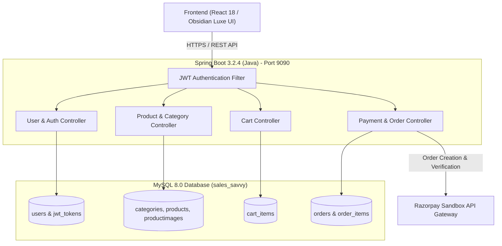

# 💎 Sales Savvy — Intelligent Enterprise E-Commerce Platform

Sales Savvy is a full-stack, enterprise-grade e-commerce application engineered in accordance with the **KodNest Project Specification & Requirement Documents (Topics 1 – 7)**.

The platform provides a consumer storefront and an administrative operations console with **Role-Based Access Control (RBAC)**, relational data integrity, **JWT security**, and **Razorpay Sandbox Payment Gateway** integration.

---

## 🎨 Unique UI Design System: *Obsidian Luxe & Auric Luminescence*

Rather than using repetitive generic e-commerce templates (plain white bootstrap or basic dark mode), Sales Savvy features a custom aesthetic designed to wow users:

- **Primary Canvas**: Cosmic Obsidian (`#090D16`) with Dark Slate depth layers (`#0F172A`).
- **Brand Accent**: Auric Cyber Gold (`#F59E0B` & `#FBBF24`) representing premium luxury and focus.
- **Secondary Luminescence**: Electric Indigo (`#6366F1`) & Violet Aura (`#818CF8`).
- **Success & Action Accents**: Emerald Mint (`#10B981`) for purchase verifications and stock indicators.
- **Surface Elevation**: Frosted Glassmorphism (`rgba(22, 32, 54, 0.7)`) with backdrop blur (`16px`) and subtle borders (`rgba(255, 255, 255, 0.08)`).
- **Typography**: Geometric modern typography via **Plus Jakarta Sans** with tabular monospacing via **JetBrains Mono** for pricing and invoice tracking.

---

## 🏗️ System Architecture & Module Plan

The platform is divided into **7 discrete modules** matching the requirement documentation:



---

### Module-by-Module Breakdown Plan

| Module | Scope & Objectives | Key API Endpoints | Database Tables Involved |
| :--- | :--- | :--- | :--- |
| **Module 1: SRS & Role Architecture** | Role matrix implementation: `ADMIN` vs `CUSTOMER`. Session boundaries, route guards, and privilege isolation. | N/A (Architecture) | `users` |
| **Module 2: Database Modeling** | Relational schemas with foreign key integrity, cascades, indexing, and seed catalog with CDN assets. | N/A (DDL Scripts) | All 8 tables |
| **Module 3: User Registration** | Secure customer signup with client & server-side regex validation, BCrypt password hashing, and role assignment. | `POST /api/users/register` | `users` |
| **Module 4: Authentication & Security** | Login verification, JWT issuance, `HttpOnly` Secure cookie storage, and automated role-based navigation. | `POST /api/auth/login`<br>`POST /api/auth/logout`<br>`GET /api/auth/me` | `users`, `jwt_tokens` |
| **Module 5: Product Management** | Catalog browsing, category pills filtering, real-time live search, Quick View modal, and Admin CRUD operations. | `GET /api/products`<br>`GET /api/categories`<br>`POST /api/products` (Admin)<br>`DELETE /api/products/{id}` | `categories`, `products`, `productimages` |
| **Module 6: Cart Management** | Dynamic cart state, stock validation, quantity steppers, item removal, and subtotal + **₹370 flat shipping** calculation. | `GET /api/cart`<br>`POST /api/cart/add`<br>`PUT /api/cart/update`<br>`DELETE /api/cart/{id}` | `cart_items`, `products` |
| **Module 7: Razorpay Payment & Orders** | Order initiation with Razorpay Sandbox, payment signature verification, invoice persistence, and live order tracking. | `POST /api/payment/create-order`<br>`POST /api/payment/verify`<br>`GET /api/orders/user` | `orders`, `order_items` |

---

## 📂 Project Directory Structure

```
sales savvy/
├── README.md                      # Comprehensive project documentation
├── Project Requirements/          # 27 requirement slides from KodNest
├── database/
│   └── schema.sql                 # Complete MySQL 8.0 DDL & initial seed data
├── backend/                       # Spring Boot 3.2.4 Backend (Skeleton)
│   ├── pom.xml                    # Maven dependencies (JPA, Security, JJWT, MySQL)
│   └── src/
│       └── main/
│           ├── java/com/salessavvy/
│           │   └── SalesSavvyApplication.java  # Main application starter
│           └── resources/
│               └── application.properties       # Port 9090, MySQL, JWT, CORS config
└── frontend/                      # Interactive Frontend (Obsidian Luxe Theme)
    ├── index.html                 # Standalone zero-install interactive browser app
    ├── package.json               # Vite project configuration
    ├── vite.config.js             # Vite development server settings
    ├── main.jsx                   # Vite React entry point
    └── src/
        ├── App.jsx                # Router & active view controller
        ├── styles/
        │   └── theme.css          # Obsidian Luxe & Auric Luminescence styles
        ├── services/
        │   ├── mockData.js        # Seed catalog, products, and categories
        │   └── api.js             # Dual-mode API client (LocalStorage / Spring Boot)
        ├── context/
        │   └── AppContext.jsx     # Global reactive state (Auth, Cart, Orders, Toasts)
        ├── components/
        │   ├── Navbar.jsx         # Header with live search, badges & role toggle
        │   ├── ProductCard.jsx    # Card with hover glow & add-to-cart
        │   ├── RazorpayModal.jsx  # Interactive Razorpay test payment modal
        │   └── Footer.jsx         # Brand and technical stack footer
        └── pages/
            ├── CustomerHomePage.jsx  # Hero banner, category pills & catalog grid
            ├── CartPage.jsx          # Cart management with ₹370 shipping
            ├── LoginPage.jsx         # 1-Click demo logins for Customer & Admin
            ├── RegisterPage.jsx      # Registration form with validation rules
            ├── AdminDashboard.jsx    # Real-time KPIs, product CRUD & order tracker
            └── OrderHistoryPage.jsx  # Customer order history & receipts
```

---

## 🚀 How to Run the Frontend Right Now

The frontend is ready with mock persistence in `localStorage`, so all cart additions, test orders, and admin product additions will persist across browser refreshes.

### Method 1: Instant Browser Launch (Zero Installation Required)
You can test the entire frontend immediately without needing Node.js or npm installed:
1. Open File Explorer and navigate to:
   ```
   c:\Users\Samee\Desktop\sales savvy\frontend\
   ```
2. Double-click on **`index.html`** to open it in **Google Chrome**, **Microsoft Edge**, or **Brave**.
3. **What you can test immediately:**
   - 🛍️ **Browse Products**: Filter by Electronics, Fashion, Home & Living, or Wellness.
   - 🔍 **Live Search**: Type "Aura", "Watch", or "Lamp" to instantly filter items.
   - 👁️ **Quick View Modal**: Click on any product image to see high-res details.
   - 🛒 **Cart Management**: Add items to your cart, change quantities, review the ₹370 flat shipping charge.
   - 💳 **Razorpay Sandbox Simulator**: Click "Proceed to Checkout", select UPI or Card, and simulate payment confirmation.
   - 📦 **Order Tracking**: View your newly generated order receipt under "My Orders".
   - 🛡️ **Admin Console**: Click the User Pill -> Sign In -> Click **"Admin Demo"** -> Access the **Executive Operations Dashboard** to add or delete catalog items and update order statuses!

---

### Method 2: Modern Vite Development Server (When Node.js is Installed)
If you have Node.js installed on your machine:
```bash
cd "c:\Users\Samee\Desktop\sales savvy\frontend"
npm install
npm run dev
```
The application will launch automatically at `http://localhost:3000`.

---

## 🗄️ How to Set Up the Database (MySQL 8.0)

### 1. Prerequisites
- Install **MySQL Server 8.0** or **XAMPP / WampServer**.
- Have MySQL Command Line Client or **MySQL Workbench** installed.

### 2. Import the Database Schema
1. Open your terminal or MySQL command line:
   ```bash
   mysql -u root -p
   ```
2. Enter your MySQL root password.
3. Execute the schema script located in the `database/` folder:
   ```sql
   SOURCE c:/Users/Samee/Desktop/sales savvy/database/schema.sql;
   ```
   *(Alternatively, open `database/schema.sql` in MySQL Workbench and click the Execute lightning bolt icon).*

4. Verify tables were created:
   ```sql
   USE sales_savvy;
   SHOW TABLES;
   ```
   You will see all 8 tables created:
   - `users`
   - `jwt_tokens`
   - `categories`
   - `products`
   - `productimages`
   - `cart_items`
   - `orders`
   - `order_items`

---

## ☕ How to Set Up the Backend (Spring Boot 3.2.4)

The backend structure has been set up with Spring Boot 3.2.4 and Java 17+. The business logic and service implementations are currently kept empty as requested for later implementation.

### 1. Database Credentials Configuration
Open [backend/src/main/resources/application.properties](file:///c:/Users/Samee/Desktop/sales%20savvy/backend/src/main/resources/application.properties) and update your MySQL username and password:
```properties
spring.datasource.url=jdbc:mysql://localhost:3306/sales_savvy?useSSL=false&serverTimezone=UTC&allowPublicKeyRetrieval=true
spring.datasource.username=root
spring.datasource.password=YOUR_MYSQL_PASSWORD_HERE
```

### 2. Build the Backend Using Maven
Open your terminal in the backend directory:
```bash
cd "c:\Users\Samee\Desktop\sales savvy\backend"
mvn clean package -DskipTests
```

### 3. Run the Spring Boot Server
```bash
mvn spring-boot:run
```
The backend will boot up on port `9090` (`http://localhost:9090`).

---

## 🔗 How to Connect Frontend to Backend

When we implement the backend services:

1. **API Port Alignment**:
   - The Spring Boot server runs at `http://localhost:9090`.
   - The frontend's API service is configured in [frontend/src/services/api.js](file:///c:/Users/Samee/Desktop/sales%20savvy/frontend/src/services/api.js) with:
     ```javascript
     const BASE_URL = 'http://localhost:9090/api';
     ```

2. **CORS Configuration**:
   - In [backend/src/main/resources/application.properties](file:///c:/Users/Samee/Desktop/sales%20savvy/backend/src/main/resources/application.properties), CORS is already configured to accept requests from the frontend:
     ```properties
     app.cors.allowed-origins=http://localhost:3000,http://127.0.0.1:3000
     ```

3. **Authentication via Cookies**:
   - When the backend is ready, `POST /api/auth/login` will set an `HttpOnly` cookie containing the JWT.
   - The frontend includes `credentials: 'include'` on all `fetch` requests so browser sessions and RBAC operate without manual token handling.

---

## 🎯 Next Steps

1. Review and test the frontend UI by opening `frontend/index.html`.
2. Review the module plan and database schema.
3. Once satisfied, we will implement the backend services, controllers, entities, and repositories step-by-step!
